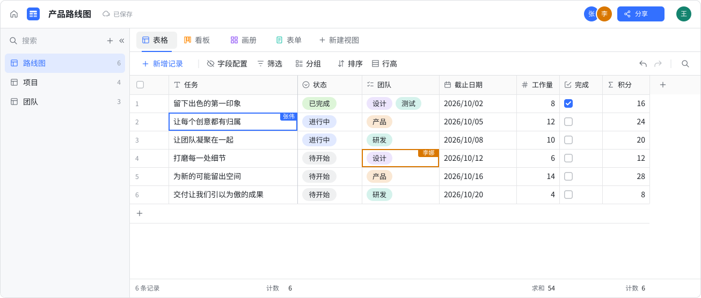

<p align="center">
  <picture>
    <source media="(prefers-color-scheme: dark)" srcset="assets/logo-dark.svg">
    
  </picture>
</p>

<p align="center"><strong>Yet another collaborative spreadsheet.</strong></p>

<p align="center">
  <a href="README.md">English</a> ·
  <a href="https://sayrud.com/">Official Site</a> ·
  <a href="https://docs.sayrud.com">Documents</a> ·
  <a href="https://docs.sayrud.com/blog">Blog</a> ·
  <a href="docs/swagger.yaml">API</a>
</p>

<p align="center">
  <picture>
    <source media="(prefers-color-scheme: dark)" srcset="assets/product-preview-zh-CN-dark.svg">
    
  </picture>
</p>

## ✨ 功能介绍

Sayrud 是一款可以自己部署的协作式多维表格，用来整理项目、任务和共享数据，并通过工作流自动处理业务。

- 同一张数据表支持表格、看板、画册和表单视图，每个视图可独立设置筛选、排序、分组和可见字段。
- 支持文本、数字、日期、单选、多选、复选框、附件和公式字段。
- 支持多实例部署下的多人实时编辑，显示在线成员和正在编辑的单元格。
- 可视化工作流：通过 API 请求、记录变化、日期到达或定时计划触发，支持查询、新增和更新记录、条件分支、发送邮件及 HTTP 请求，
  并提供调试、运行历史与版本回滚。
- 沙箱 JavaScript 插件可扩展工作流节点与外部集成，支持网络访问权限控制，可添加自定义凭证。
- 字段捷径：管理员可发布 JavaScript 自定义捷径；引用字段变化后自动重新生成。
- 将 CSV、TSV 和 Excel（`.xlsx`/`.xlsm`）导入到新表或已有表，支持数据预览、字段类型自动识别与字段映射。
- 可配置 OAuth2、OIDC、SAML 单点登录和 LDAP 身份验证，内置 GitHub、Google、Microsoft、Keycloak 等配置模板。
- 提供 REST API 和 [OpenAPI 描述文件](docs/swagger.yaml)。

## 🚀 部署方式

需要 Docker 和 Docker Compose v2。镜像包含前后端，Compose 会一起启动 Sayrud、PostgreSQL 和 Redis。

```sh
git clone https://github.com/sayrud/sayrud.git
cd sayrud
cp config/sayrud.example.yaml config/sayrud.yaml
```

编辑 `config/sayrud.yaml`，将 PostgreSQL 主机改为 `postgres`，Redis 地址改为 `redis:6379`。
生产环境中，将 `postgres.dsn` 的密码和 `docker-compose.yaml` 中的 `POSTGRES_PASSWORD` 改为相同值。
默认密码 `change-me` 仅供本地运行使用。Compose 会以只读方式挂载 `config/sayrud.yaml`。

```sh
docker compose up -d
```

打开 <http://localhost:2830> 完成安装向导。向导会要求填写日志中打印的一次性安装令牌，可运行
`docker compose logs sayrud | grep "Setup token"` 查看；也可以通过环境变量 `SAYRUD_SETUP_TOKEN` 自行指定令牌。随后创建系统管理员即可。
数据保存在 `postgres_data` 卷中。

没有配置文件时，向导还会要求填写 PostgreSQL 和 Redis 连接，并写入配置文件，同时自动生成加密密钥。

更新镜像：

```sh
docker compose pull
docker compose up -d
```

## 🤝 贡献开发

欢迎提交 Issue 和 Pull Request。报告 Bug 时请附上复现步骤，提交代码时尽量一次只改一个问题。

开发需要 Go 1.27、Node.js 22.13 或更新版本和 pnpm 10。Go 后端在 `cmd/` 和 `internal/`，Vue 和 TypeScript 前端在
`frontend/`。

只启动数据库，复制本地配置，再构建一次前端：

```sh
docker compose up -d --wait postgres redis
cp config/sayrud.example.yaml config/sayrud.yaml
pnpm --dir frontend install --frozen-lockfile
pnpm --dir frontend build
go run ./cmd/sayrud-server web
```

服务默认监听 `2830` 端口，可通过 `--port` 指定其他端口，通过 `--config` 指定其他配置文件。

自定义 `docker-compose.yaml` 中的数据库初始化密码后，需要将 `config/sayrud.yaml` 中的 PostgreSQL 连接密码改为相同值。
Compose 应用若占用了 `2830` 端口，先运行 `docker compose stop sayrud`。

另开一个终端运行 `pnpm --dir frontend dev`，打开 <http://localhost:5173>。Vite 会将 API 和 WebSocket 请求代理到后端。生产构建通过
`go:embed` 打包 `frontend/dist`。

提交前运行：

```sh
pnpm --dir frontend lint
pnpm --dir frontend test
pnpm --dir frontend build
go test ./...
```

修改 API 定义后，运行 `bash scripts/generate.sh` 更新 OpenAPI 文件和前端客户端。

## ⚖️ License

采用 [AGPL-3.0](LICENSE) 许可证。
